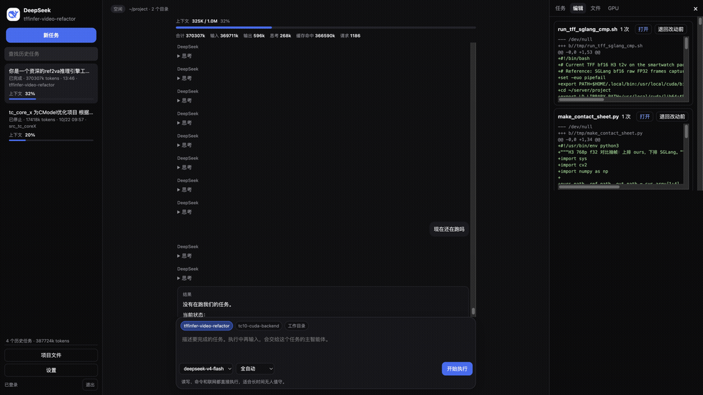
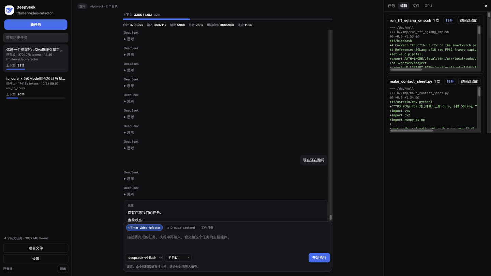
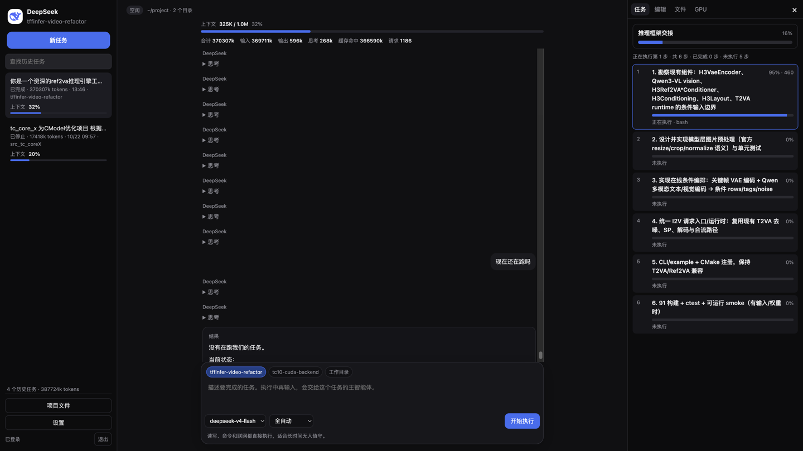
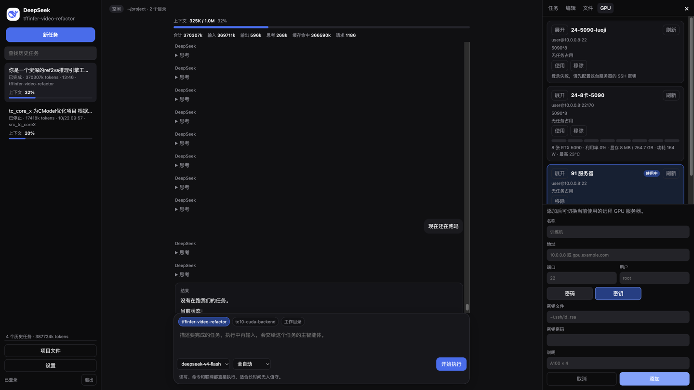

# DeepSeek Agent

本仓库是 DeepSeek Agent 桌面界面。它基于 [Deep Code CLI 0.4.3](https://github.com/lessweb/deepcode-cli)，在本机用 Electron 窗口操作项目。

## 启动

需要 Node.js 22 或更高版本。

```bash
npm install
npm run studio
```

账户、模型和接口地址写在 `~/.deepcode/settings.json`，与命令行版共用。

## 界面



左侧是历史任务，中间是对话，右侧可以在任务、编辑、文件和 GPU 之间切换。



一个任务只有一个主智能体。执行中再输入，仍交给这个主智能体。需要分出去的工作才由它安排子智能体。工作模式有全自动、项目内自动、先确认、只规划。



任务页展开后可以看到每一步的进度。编辑页保留文件改动，也可以打开或退回。



GPU 页可以添加远程服务器，登录可选 SSH 密码或密钥。密钥可以填写密钥文件和密钥密码。这里只显示哪台服务器被占用以及显卡状态，命令仍在本地项目里执行。

界面代码在 `packages/studio`，智能体运行依赖 `packages/core`。上游命令行说明见 [README-zh_CN.md](README-zh_CN.md)。
